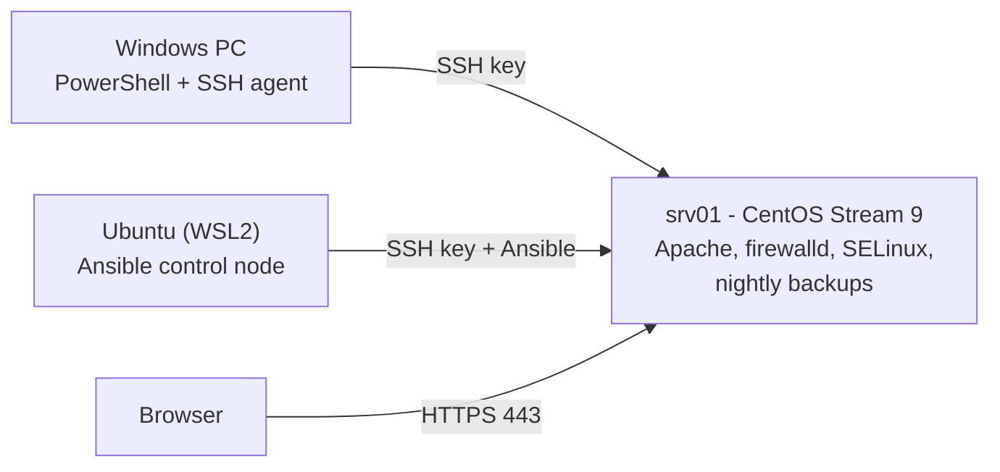

# srv01 Home Lab

A hands-on Linux system administration lab: a CentOS Stream 9 server built, hardened, and managed from scratch, then automated with Ansible.

## Architecture



## What's built

- **Access:** SSH key-only login, root login disabled, least-privilege sudo for a junior admin group
- **Security:** firewalld allowing only SSH, HTTP and HTTPS; SELinux enforcing; automatic updates with dnf-automatic
- **Web:** Apache serving a custom site over HTTPS, with HTTP redirected to HTTPS
- **Backups:** nightly archive via a systemd timer, 7-day retention, restore drill tested
- **Automation:** Ansible playbook that enforces SSH hardening and corrects configuration drift

## Lessons learned

- **Lockout recovery:** after losing a key passphrase, regained access through the VM console, then moved to an SSH agent and a password manager.
- **SELinux labels:** a site moved to /srv returned 403 because of the var_t label; fixed with semanage fcontext and restorecon instead of disabling SELinux.
- **Restore drills matter:** the first restore brought back the files with the wrong SELinux labels, so the site stayed down. Fixed by archiving with tar --selinux.
- **Configuration drift:** the SSH hardening file was found disabled. An Ansible playbook now detects and fixes it automatically.

## Files

| File | Purpose |
|---|---|
| ansible.cfg | Ansible settings for this project |
| inventory.ini | List of managed servers |
| ssh-hardening.yml | Playbook that enforces SSH hardening |

## Run it

```bash
ansible-playbook ssh-hardening.yml -K --check --diff   # dry run
ansible-playbook ssh-hardening.yml -K                  # apply
```
